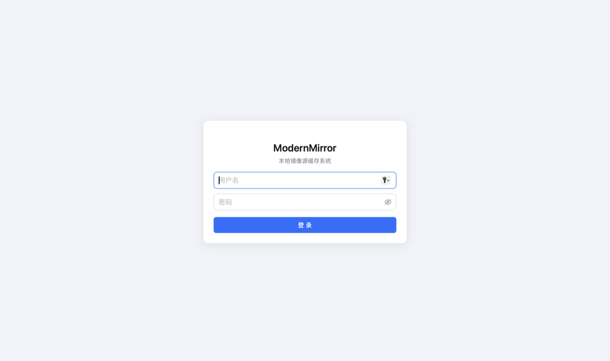
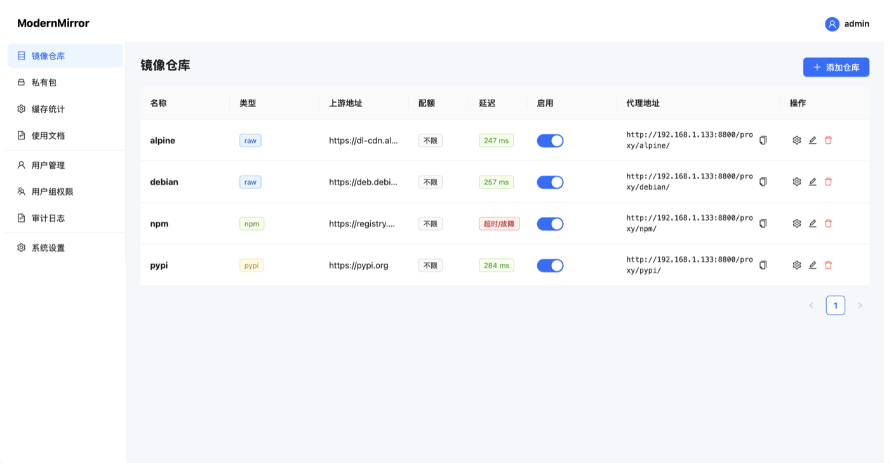
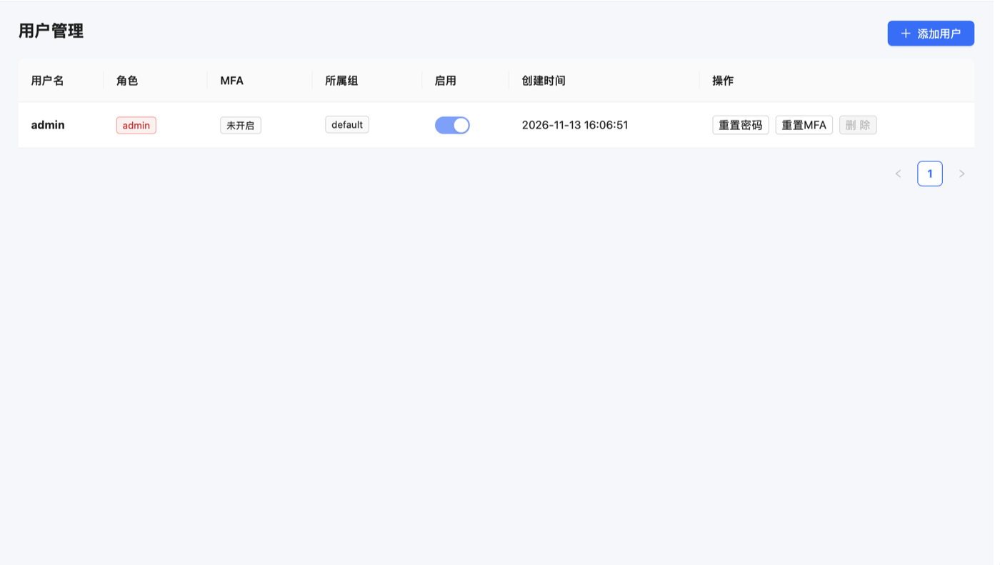
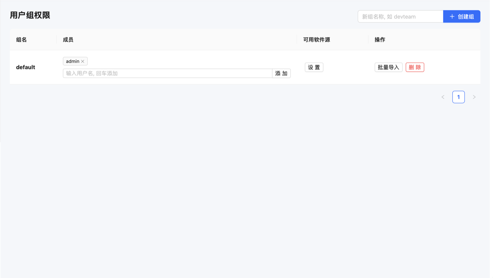
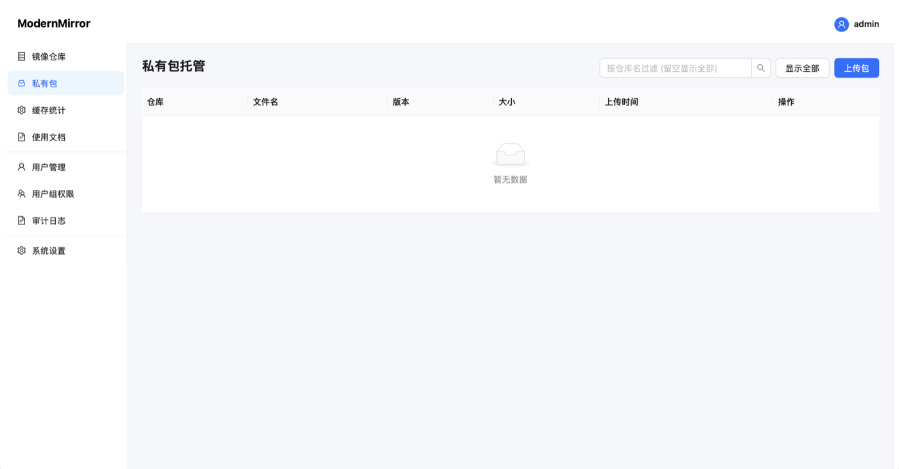
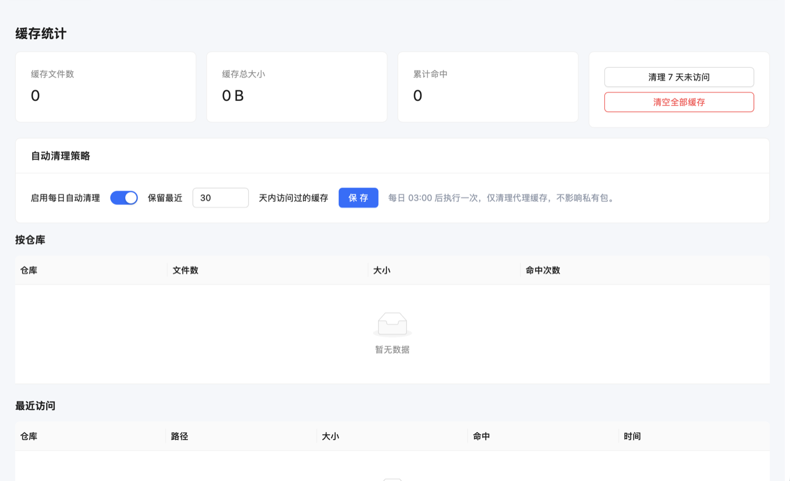
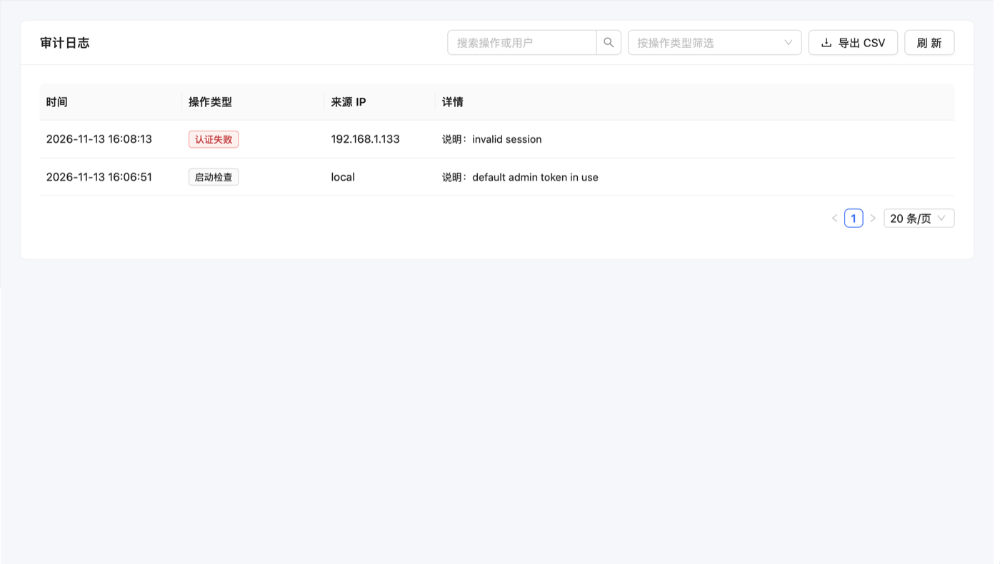
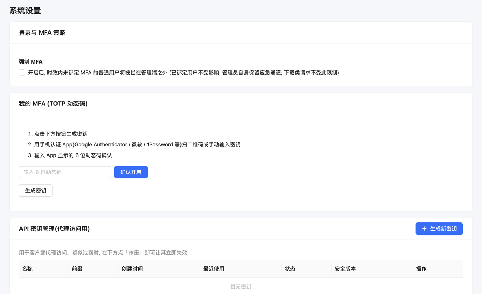
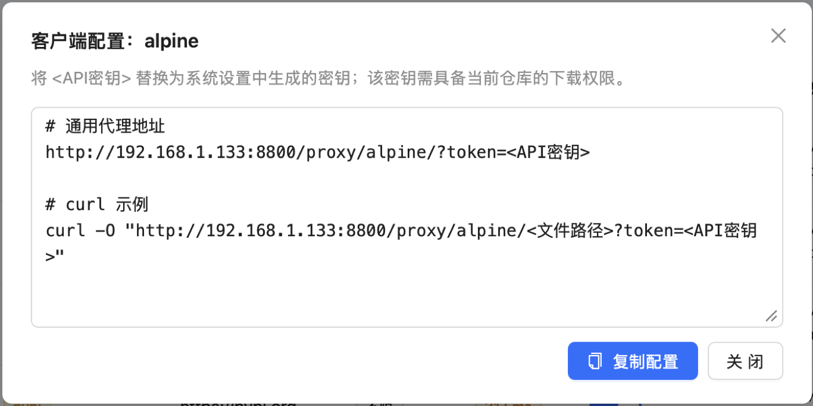
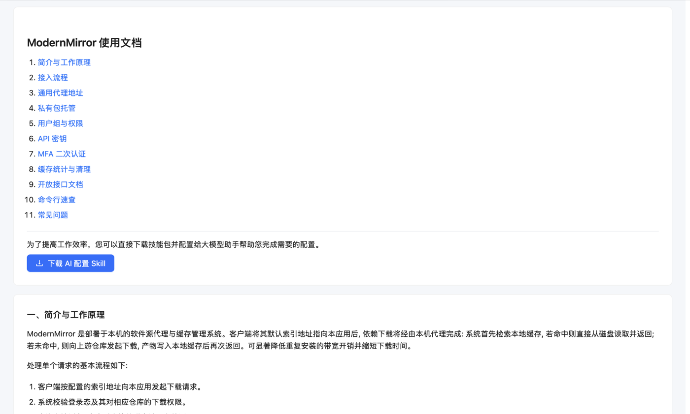

<p align="center">
  
</p>

<h1 align="center">ModernMirror Cangjie</h1>

<p align="center"><strong>A self-hosted package mirror and proxy cache written in Cangjie.</strong><br>
One entry point for every package source in your network, with local caching, access control, and portable data.</p>

<p align="center">English | <a href="README.md">简体中文</a></p>

> ModernMirror is not affiliated with Nexus, Verdaccio, or similar projects. It is an independent implementation.

## What's new in 1.1.25

- Settings are available to every role: regular users can enable or disable their own MFA and manage their own API keys
- Repositories can allow anonymous downloads, which solves plain-HTTP clients such as Go and CocoaPods that cannot send credentials
- Client configuration for 15 ecosystems, with a "Configure" button available to regular users for repositories they can read
- Absolute download URLs in pypi, npm, pub, crates, and NuGet metadata are rewritten back to this proxy so artifacts are cached
- pip wheels and sdists no longer bypass the proxy; Range requests on cold cache fetch the full file before serving a segment
- The built-in AI configuration skill at `skills/SKILL.md` is served at `/skill/modernmirror-config/SKILL.md`

## Design goals

- **Single binary**: the build output is one executable, with no extra language runtime or virtual environment
- **Fast startup**: cold start takes milliseconds, which suits containers and low-end devices
- **Strong security foundation**: [openHiTLS](https://gitcode.com/openHiTLS/openHiTLS) as the primary provider and Cangjie stdx as the fallback, with native Chinese cryptographic algorithms
- **Self-contained data**: database, ciphertexts, and master key live together in the data directory, so a copy is enough to migrate or back up

## Features

- **Transparent proxy cache**: the first request fetches from upstream and stores the artifact; later requests read from local disk. ETag revalidation and `X-Cache-Status` are supported
- **Many ecosystems out of the box**: PyPI, npm, Go Modules, Maven/Gradle, NuGet, RubyGems, Crates, Conan, pub, Hex, Hackage, CRAN, LuaRocks, CocoaPods, and apt
- **Anonymous read-only repositories**: enable anonymous downloads per repository; uploads and private package APIs still require authentication
- **Response rewriting**: npm `dist.tarball`, pub `archive_url`, crates `config.json.dl`, and NuGet service-index `@id` values point back to this proxy
- **Upstream failover**: each repository supports a primary upstream plus ordered fallbacks
- **Cache governance**: per-repository hit and size statistics, quotas, LRU eviction, retention cleanup, and a daily scheduled cleanup
- **Private packages**: upload internal artifacts, download them directly, and expose a PEP 503 simple index
- **Users and permissions**: multi-user login, group-to-repository read and write matrix, and bulk member import
- **MFA**: standard TOTP compatible with any authenticator, with enforcement policy, self-service toggling, and admin reset
- **API keys**: issue and revoke credentials for automation and command line use
- **Integrity checks**: PyPI index hashes and npm `integrity` values are verified before anything is cached
- **Security**: PBKDF2-SM3 for passwords, SM4 in authenticated mode for sensitive data, legacy data migration supported
- **Audit log**: logins, repository changes, uploads, deletions, and integrity failures are written to a protected audit log

## Screenshots

<table>
  <tr>
    <td width="50%"><br><sub>Login page</sub></td>
    <td width="50%"><br><sub>Repositories and upstream latency</sub></td>
  </tr>
  <tr>
    <td width="50%"><br><sub>Users and MFA state</sub></td>
    <td width="50%"><br><sub>Groups and repository matrix</sub></td>
  </tr>
  <tr>
    <td width="50%"><br><sub>Private packages</sub></td>
    <td width="50%"><br><sub>Cache statistics and cleanup</sub></td>
  </tr>
  <tr>
    <td width="50%"><br><sub>Audit log</sub></td>
    <td width="50%"><br><sub>Settings and API keys</sub></td>
  </tr>
  <tr>
    <td width="50%"><br><sub>Client configuration</sub></td>
    <td width="50%"><br><sub>Built-in documentation</sub></td>
  </tr>
</table>

## Architecture

```
pip / npm / curl / apt clients
        │
        ▼
  stdx.net.http with a custom router
        │
   authentication and group permissions
        │
   SQLite cache lookup ──hit──▶ stream from local disk
        │
        miss
        ▼
   stdx.net.http client with upstream failover
        │
   integrity check ──failure──▶ reject and audit
        │
   atomic cache write and response
```

All sources live in a single package under `src/`, split by responsibility:

```
src/
├── http.cj            HTTP entry point and router, handling responses and static assets
├── routes_auth.cj     login, MFA, password change, identity, and API key endpoints
├── routes_admin.cj    users, groups, repositories, stats, packages, audit, and settings
├── admin_import.cj    bulk group member import and template downloads
├── proxy.cj           proxy cache core for upstream fetches, verification, ranges, and quotas
├── private.cj         private package upload, download, and simple index
├── auth.cj            session management, authentication, and repository permission checks
├── crypto.cj          openHiTLS wrapper for Chinese cryptographic algorithms and TOTP
├── sqlite.cj          low-level SQLite C API bindings and statement execution
├── db.cj              schema initialization, migrations, and query helpers
├── storage.cj         cache writes, disk usage stats, and eviction cleanup
├── security.cj        audit logging, rate limiting, and sensitive data protection
├── config.cj          environment variables, data directories, and master key setup
├── docs.cj            built-in API documentation and OpenAPI generation
└── util.cj            path, JSON, time, and string helpers
```

## Quick start

### Requirements

Linux and macOS can be deployed directly. Native Windows builds are not supported yet; install WSL2 and follow the Linux steps.

| System | Architecture | Status |
|---|---|---|
| Linux | x86_64 | Supported |
| Linux | aarch64 | Supported, tested on fnOS |
| macOS | arm64 | Supported, tested |
| macOS | x86_64 | Configured, not tested |
| Windows | x86_64 | No native build yet, use WSL2 |

> Native Windows builds are not supported because the build scripts and native dependencies such as SQLite and openHiTLS are currently wired for POSIX toolchains only.

Toolchains and their purpose:

| Tool | Purpose | Linux install | macOS install |
|---|---|---|---|
| [Cangjie SDK](https://cangjie-lang.cn/download/1.0.5) | Build the backend | [Official download](https://cangjie-lang.cn/download/1.0.5) | [Official download](https://cangjie-lang.cn/download/1.0.5) |
| [Cangjie stdx](https://gitcode.com/Cangjie/cangjie_stdx) | Networking, JSON, and other extensions | [Official repository](https://gitcode.com/Cangjie/cangjie_stdx) | [Official repository](https://gitcode.com/Cangjie/cangjie_stdx) |
| C compiler | Build openHiTLS | `build-essential` | Xcode Command Line Tools |
| CMake | Build openHiTLS | `cmake` | `brew install cmake` |
| SQLite | Database | `libsqlite3-dev` | Included with the system |
| zlib | Compression support | `zlib1g-dev` | Included with the system |
| Node.js | Build the admin UI, source builds only | NodeSource or nvm | `brew install node` |
| OpenSSL | TLS at runtime | `libssl-dev` | `brew install openssl@3` |
| Git | Fetch sources and dependencies | `git` | Included with the system |

> Version requirements are Cangjie SDK 1.0.5 or newer, CMake 3.20 or newer, and Node.js 18 or newer.

On Ubuntu and Debian, install every system dependency except the Cangjie SDK and stdx in one step:

```bash
sudo apt update
sudo apt install -y build-essential cmake git libsqlite3-dev zlib1g-dev libssl-dev ca-certificates
```

Ubuntu 22.04 ships an older Node.js. When building the admin UI, install version 18 or newer through NodeSource or nvm.

On macOS, install every system dependency except the Cangjie SDK and stdx in one step:

```bash
xcode-select --install
brew install cmake node openssl@3
```

On Windows, install WSL2 with Ubuntu 22.04 first, then follow the Ubuntu steps above:

```bash
wsl --install -d Ubuntu-22.04
```

### One-step deployment

```bash
git clone https://192.168.3.42:28361/andyjin/ModernMirror-Cangjie.git
cd ModernMirror-Cangjie
./scripts/setup.sh
./scripts/build.sh
./scripts/run.sh
```

`setup.sh` performs three steps:

1. Copies the local stdx prebuilt libraries into `.deps/stdx/`
2. Clones and builds openHiTLS into `.deps/hitls/`
3. Installs frontend dependencies and builds them into `frontend/dist/`

#### Optional configuration

**1. Custom stdx path**

If stdx lives somewhere unusual, point the script at it:

```bash
CANGJIE_STDX_DIR=/path/to/cangjie-stdx-linux-x64-1.0.5.1 ./scripts/setup.sh
```

**2. Custom openHiTLS source**

By default, openHiTLS is shallow cloned from the official GitCode repository and then built. To use another source or a local checkout, set:

```bash
OPENHITLS_REPO=https://github.com/openHiTLS/openHiTLS.git ./scripts/setup.sh
OPENHITLS_SRC_DIR=/path/to/openHiTLS ./scripts/setup.sh
```

`OPENHITLS_REPO` sets the clone URL, and `OPENHITLS_SRC_DIR` points to a local source directory. An existing directory is reused without cloning again.

**3. Skip the frontend build**

If you only need the backend, skip the frontend build:

```bash
SKIP_FRONTEND=1 ./scripts/setup.sh
```

### Run

```bash
MODERNMIRROR_DATA=./data \
MODERNMIRROR_PORT=8800 \
./scripts/run.sh
```

Endpoints:

- Admin UI at `http://localhost:8800/ui/`
- API documentation at `http://localhost:8800/docs` or `http://localhost:8800/redoc`, both require an admin login

The first start creates an administrator `admin / admin123` and generates `data/master.key`. **Change the password immediately and create an API key in settings.**

### Migrate an existing data directory

The database schema and ciphertext format remain backward compatible. Stop the old service and point `MODERNMIRROR_DATA` at the previous data directory:

```bash
MODERNMIRROR_DATA=/path/to/old-data ./scripts/run.sh
```

Back up the database and `master.key` first. Protected data cannot be recovered if the key is lost.

## Configuration

All settings come from environment variables. Items with defaults may be omitted.

| Variable | Default | Description |
|---|---|---|
| `MODERNMIRROR_DATA` | `data` | Data directory holding the database, cache, private packages, audit log, and master key |
| `MODERNMIRROR_HOST` | `0.0.0.0` | Listen address |
| `MODERNMIRROR_PORT` | `8800` | Listen port |
| `MODERNMIRROR_DIST` | auto detected | Frontend static asset directory |
| `MODERNMIRROR_TOKEN` | unset | Emergency admin token. The default `admin-token` is deliberately ignored |
| `MODERNMIRROR_ADMIN_USER` | `admin` | Administrator name created on first start |
| `MODERNMIRROR_ADMIN_PASSWORD` | `admin123` | Administrator password created on first start |
| `MODERNMIRROR_DB_MASTER_KEY` | generated | Master key. Takes priority over `data/master.key` |
| `MODERNMIRROR_MAX_MB` | `2048` | Maximum size of a single proxied file |
| `MODERNMIRROR_MAX_UPLOAD_MB` | `2048` | Maximum size of a single private package |
| `MODERNMIRROR_RATE_LIMIT` | `600` | Requests per IP per 60 seconds |
| `MODERNMIRROR_SESSION_HOURS` | `24` | Initial session lifetime |
| `MODERNMIRROR_WEB_SESSION_MINUTES` | `30` | Sliding web session timeout |

## Usage

Proxy URL format:

```
http://<host>:8800/proxy/<repo>/<original path>
```

Authentication sources (choose what your client supports):

1. `Session-Token: <API key>` header
2. `Authorization: Bearer <API key>` header
3. HTTP Basic with any username and the API key as password
4. `?token=<API key>` query parameter

`?token=` is fine for one-off `curl` calls, but most package managers will fold the token into a sub-path or drop the query string when requesting package files. Prefer Basic auth or the client's own token setting.

### Anonymous read-only repositories

Every repository has an "allow anonymous downloads" switch. When enabled, reads through the proxy no longer require a login; uploads and private package APIs still require authentication. Enable it for clients such as Go and CocoaPods that cannot send credentials over plain HTTP.

### Ecosystem examples

**Python / pip**

```bash
pip config set global.index-url "http://mm:<API_KEY>@HOST:8800/proxy/pypi/simple/"
pip install requests
```

**Node.js / npm**

```bash
npm config set registry "http://HOST:8800/proxy/npm/"
npm config set //HOST:8800/proxy/npm/:_authToken "<API_KEY>"
npm install antd
```

**Go Modules**

```bash
# plain HTTP cannot carry credentials; enable anonymous downloads for this repo
export GOPROXY="http://HOST:8800/proxy/go"
export GOSUMDB=off
go get example.com/module@latest
```

**Maven / Gradle**

```xml
<mirror>
  <id>modernmirror</id>
  <mirrorOf>central</mirrorOf>
  <url>http://HOST:8800/proxy/maven/</url>
</mirror>
```

**apt**

```bash
deb http://mm:<API_KEY>@HOST:8800/proxy/debian bookworm main
```

NuGet, RubyGems, Crates, Conan, pub, Hex, Hackage, CRAN, LuaRocks and CocoaPods are covered by the built-in docs page; the "Client config" button on each repository row generates a ready-to-copy command for that repository type.

### Response rewriting

The server rewrites npm `dist.tarball`, pub `archive_url`, crates `config.json.dl` and NuGet v3 service-index `@id` values back to this proxy, so package files also flow through the cache. For crates use `https://index.crates.io` as the upstream (the generated `config.json` includes `auth-required` based on the anonymous setting). For NuGet use `https://api.nuget.org`; cross-host 302 redirects are followed server-side.

See the built-in documentation page for more clients, or use `skills/SKILL.md` to let an AI tool configure and roll back the settings.

## Private packages

Upload from the private packages page in the admin UI, or through the API:

```bash
curl -H "Session-Token: <API_KEY>" \
  -F "file=@my-package-1.0.0.whl" \
  "http://HOST:8800/admin/packages/my-repo"
```

Download and index paths:

```
/pkg/<repo>/<file name>
/simple/<repo>
```

## Permission model

- The admin role only affects management APIs. Proxy access still requires a group grant
- New users join the `default` group automatically, but that group still needs repository grants
- Admins are not restricted by group permissions when uploading private packages
- Disabled users cannot log in and existing sessions stop working immediately
- The last enabled administrator cannot be deleted or disabled

## Security

- **HTTPS upstreams only**: plain HTTP upstreams are rejected when a repository is created or updated
- **Artifact verification**: PyPI index hashes and npm `dist.integrity` are compared, and mismatches return 502 without caching
- **Secure by default**: the master key is generated on first start, and audit logs plus MFA secrets are protected
- **Session safety**: only SM3 hashes of session tokens are stored, with sliding expiry and immediate revocation
- **Path safety**: cache files are addressed by digest, upload names are reduced to basenames, and repository names use an allowlist
- **Limits**: per-file caps, upload caps, and per-IP rate limiting
- **Auditing**: login failures, permission changes, uploads, deletions, and integrity failures are written to the protected audit log

Before exposing the service publicly:

1. Set a strong random `MODERNMIRROR_TOKEN`
2. Put Nginx or Caddy in front to terminate HTTPS
3. Back up `data/master.key`
4. Back up the database and private packages regularly

## Data and backups

```
data/
├── modernmirror.db      SQLite database
├── master.key           master security key
├── audit.log            protected audit log
├── cache/               proxy cache, safe to delete
└── private/             private package files
```

Back up `modernmirror.db`, `master.key`, and `private/`. The cache can be rebuilt at any time.

## Development

### Prepare dependencies

Prepare dependencies without building the frontend:

```bash
SKIP_FRONTEND=1 ./scripts/setup.sh
```

### Build and self check

Rebuild:

```bash
./scripts/build.sh
```

The binary is written to `target/release/bin/main`. It needs the Cangjie runtime libraries at runtime; `scripts/run.sh` sets the paths automatically.

Run the self check, which covers health, login, repositories, the API docs, and the built-in AI skill:

```bash
./scripts/smoke.sh
```

### End-to-end tests

Both test scripts create and delete users and repositories, so start the service with a fresh data directory for each one. `proxy_test.py` also needs access to the public npm and crates registries:

```bash
# APIs, permissions, MFA, and the built-in skill
rm -rf /tmp/mm-api && MODERNMIRROR_DATA=/tmp/mm-api MODERNMIRROR_PORT=8899 ./scripts/run.sh &
MM_BASE=http://127.0.0.1:8899 python3 tests/api_test.py

# Proxy cache, anonymous repositories, response rewriting, and quotas
rm -rf /tmp/mm-proxy && MODERNMIRROR_DATA=/tmp/mm-proxy MODERNMIRROR_PORT=8898 ./scripts/run.sh &
MM_BASE=http://127.0.0.1:8898 python3 tests/proxy_test.py
```

`MM_BASE` is the service address used by the test scripts. It must match the listen address and port used when starting the service, and defaults to `http://127.0.0.1:8899`.

### Frontend development

Start the frontend development server:

```bash
cd frontend
npm install
npm run dev
```

The dev server runs at `http://localhost:5173/ui/` and proxies API requests to `http://localhost:8800`.

## FAQ

<details>
<summary>Build fails because stdx cannot be found</summary>

Make sure the Cangjie SDK is version 1.0.5 or newer and that `scripts/setup-stdx.sh` can locate stdx. Set `CANGJIE_STDX_DIR` to the extracted directory and the script copies `static/stdx` automatically. See the [cangjie_stdx repository](https://gitcode.com/Cangjie/cangjie_stdx) for download and setup instructions.

</details>

<details>
<summary>Can I deploy on Windows</summary>

Native Windows builds are not supported yet. Install WSL2 with Ubuntu 22.04 and follow the Linux steps above.

</details>

<details>
<summary>Runtime error says libcangjie-runtime is not loaded</summary>

`envsetup.sh` was not sourced. Start through `scripts/run.sh`, which adds the runtime directory under `CANGJIE_HOME/runtime/lib`.

</details>

<details>
<summary>Requests return 401 or 403</summary>

401 means no valid credentials, 403 means the account lacks the repository permission. Check the group grants, and remember that administrators also need a group grant.

</details>

<details>
<summary>HTTPS upstreams fail</summary>

Client TLS depends on openHiTLS and the system trust store. On macOS set `DYLD_FALLBACK_LIBRARY_PATH=/opt/homebrew/opt/openssl@3/lib`; on Linux install `ca-certificates` and `libssl-dev`.

</details>

<details>
<summary>Port already in use</summary>

Change `MODERNMIRROR_PORT` or stop the process using the port.

</details>

<details>
<summary>Forgot the administrator password</summary>

Reset it through another administrator account. Without one, back up the data, remove the database, and start again. Never delete `master.key`.

</details>

## Contributing

Issues and pull requests are welcome. Please do not report security problems in public issues.

## License

[MIT](LICENSE)

ModernMirror is provided as is, without warranty regarding the availability, integrity, or compliance of external package sources. Make sure you are allowed to access and mirror the sources you configure.
