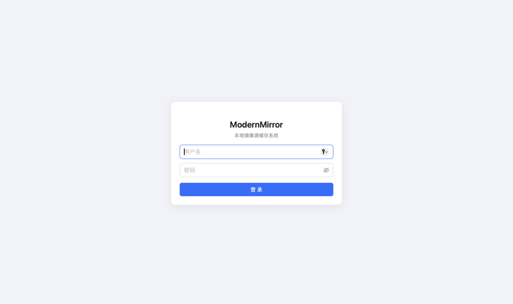
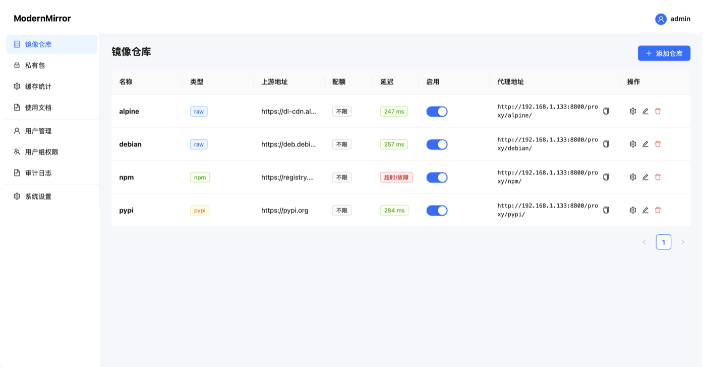
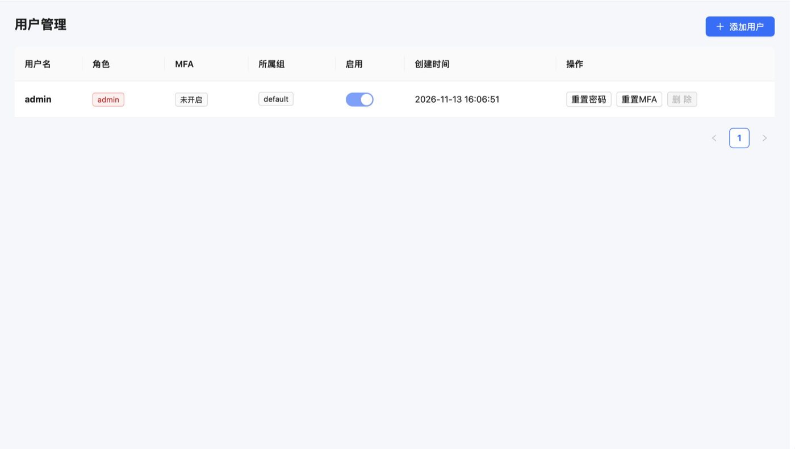
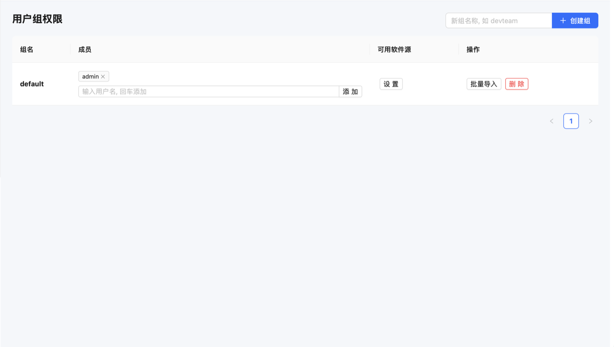
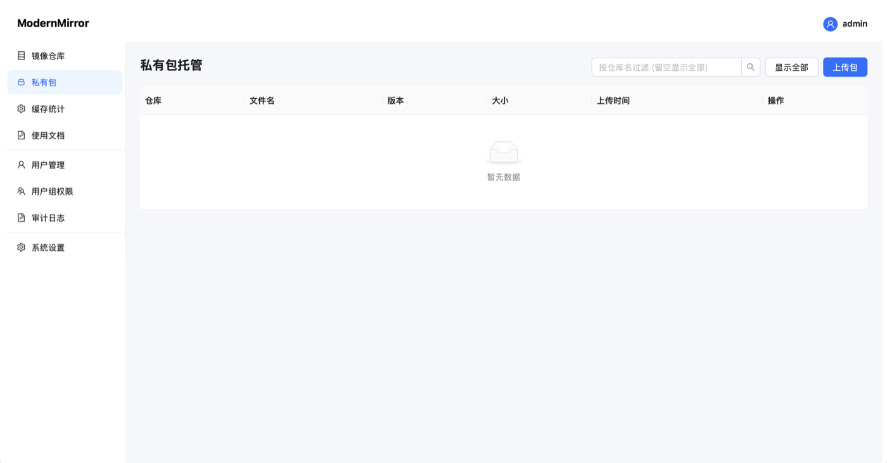
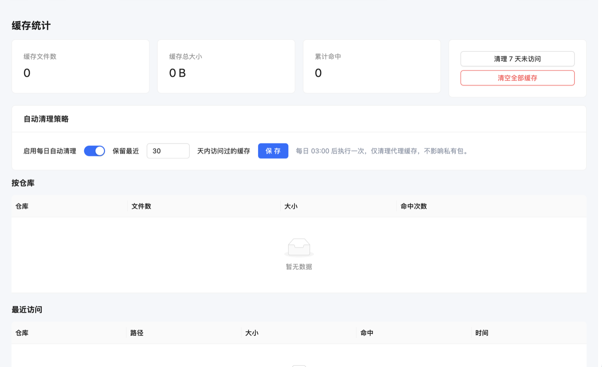
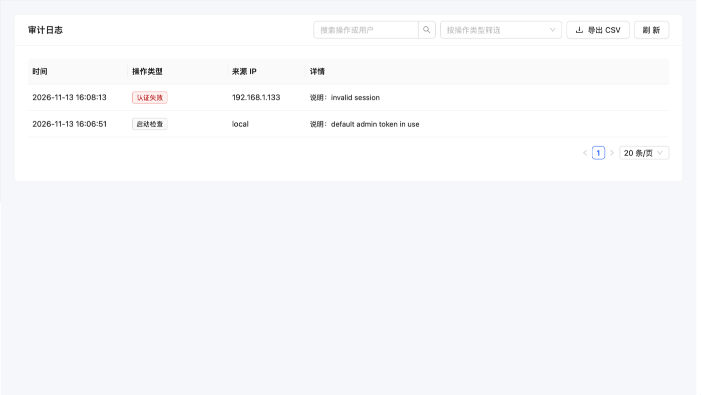
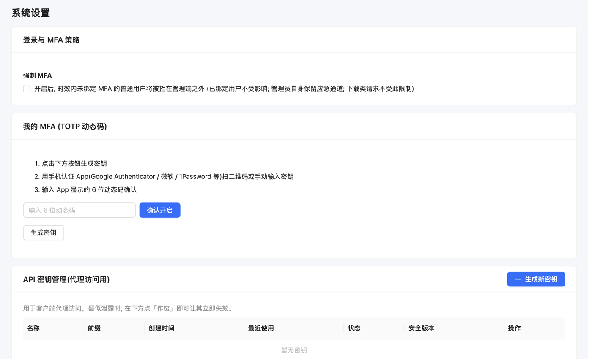
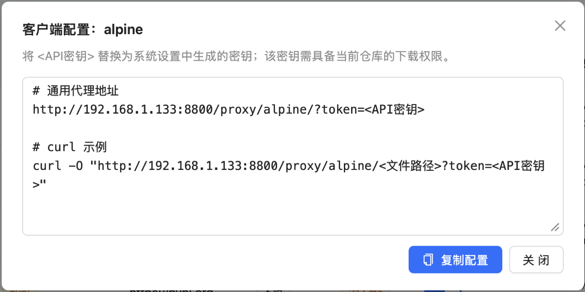
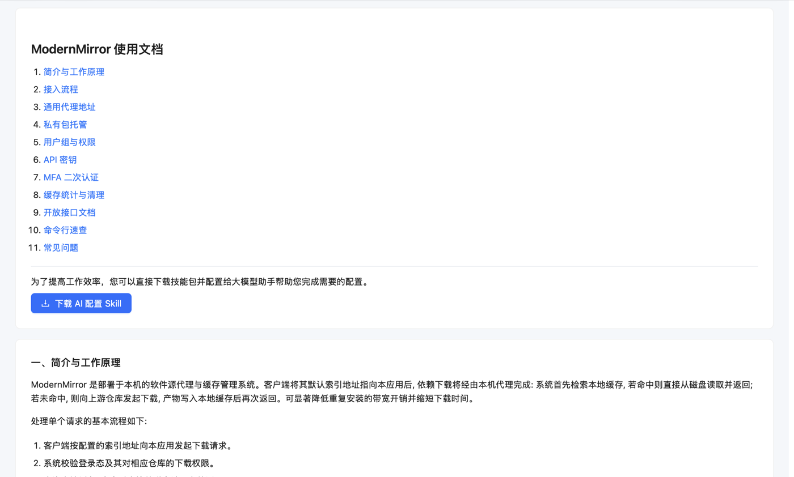

<p align="center">
  
</p>

<h1 align="center">ModernMirror Cangjie</h1>

<p align="center"><strong>用仓颉语言编写的自托管软件源代理缓存系统。</strong><br>
为团队内网提供统一的软件源入口，缓存落盘，权限可控，数据可迁移。</p>

<p align="center"><a href="README.en.md">English</a> | 简体中文</p>

> ModernMirror 与 Nexus、Verdaccio 等项目没有关联，是一个独立实现。

## 设计目标

- **单文件部署**：编译产物是单个可执行文件，无需额外语言运行时与虚拟环境
- **启动更快**：冷启动在毫秒级，适合容器与低配设备
- **安全底座**：以 [openHiTLS](https://gitcode.com/openHiTLS/openHiTLS) 为主，仓颉 stdx 兜底，国密算法走 openHiTLS 原生实现
- **数据自洽**：数据库、密文与主密钥集中在数据目录，整体复制即可完成迁移或备份

## 特性

### 代理与缓存

- **路径级透明代理**：`/proxy/<仓库>/<原始路径>` 按仓库透传到上游，保留子路径与查询串，客户端无需理解缓存层
- **内容寻址缓存**：缓存文件按 `SHA-256(repo:path)` 分片落盘，临时文件写完后原子重命名，命中时直接从磁盘流式返回
- **条件请求与分段传输**：保留上游 `ETag`，支持 `If-None-Match` 条件请求与 304 复用、`Range` 206 与 416 响应；冷缓存 Range 会先取完整文件并校验，再返回分段
- **上游故障转移与降级**：主源、备用源按序尝试，上游 5xx 或超时后回退旧缓存；`X-Cache-Status` 暴露 `fresh`、`hit`、`revalidated`、`stale` 四种状态

### 生态与协议

- **15 种生态**：PyPI、npm、Go Modules、Maven 与 Gradle、NuGet、RubyGems、Crates、Conan、Dart pub、Hex、Hackage、CRAN、LuaRocks、CocoaPods 与 apt、apk、dnf、pacman 文件型源
- **元数据地址改写**：PyPI simple 索引的 `files.pythonhosted.org`、npm `dist.tarball`、pub `archive_url`、crates `config.json.dl` 与 NuGet v3 `@id` 统一改写回代理；crates 包路径映射到 `static.crates.io`
- **跨主机重定向与 SNI**：服务端手动跟随最多 5 次 302，每个跳转目标按自身主机重建 TLS 客户端并设置 SNI，覆盖 NuGet 与 CDN 等跨域场景
- **私有包托管**：支持上传、直接下载与 PEP 503 简单索引，私有包接口独立鉴权

### 权限与安全

- **多凭证认证**：HTTP Basic（用户名任意、密码填 API 密钥）、`Authorization: Bearer`、`Session-Token`、`X-Auth-Token` 与 `?token=` 单次请求参数
- **组级 ACL 与匿名只读**：用户组到仓库的 `can_download` 与 `can_upload` 权限矩阵；仓库可按需开启匿名读取，上传与私有包接口仍需鉴权；管理员访问代理同样受组权限约束
- **会话与 API 密钥**：会话令牌只保存 SM3 哈希并支持滑动过期；API 密钥仅保存前缀与哈希，可随时单独吊销
- **TOTP 二次认证**：标准 TOTP，兼容任意认证器，支持普通用户自助开关、管理员强制策略与重置
- **完整性校验**：PyPI 比对索引哈希，npm 比对 `dist.integrity`，校验失败拒绝落盘并记录审计，防止缓存被篡改的产物
- **国密安全**：密码使用 PBKDF2-SM3，敏感数据采用 SM4-CBC 加密并以 HMAC-SM3 做完整性保护，兼容旧版数据迁移
- **加密审计日志**：登录、仓库变更、上传删除、权限调整与校验失败事件加密落盘

### 运维与可观测

- **缓存治理**：仓库级容量配额，超限按 `last_hit_at` 与 `hits` 做 LRU 淘汰；支持保留天数清理与每日自动清理
- **统计与接口文档**：按仓库统计命中率、文件数与占用空间，内置 `/docs`、`/redoc` 与 `/openapi.json`
- **单可执行文件与 SQLite WAL**：无外部服务依赖，元数据与缓存分离，数据库开启 WAL 与 30 秒忙等待
- **内置接入文档与 AI 技能**：Web 文档覆盖 15 类客户端配置，`/skill/modernmirror-config/SKILL.md` 可供 AI 工具直接读取并执行配置或回滚

## 界面预览

<table>
  <tr>
    <td width="50%"><br><sub>登录页面</sub></td>
    <td width="50%"><br><sub>镜像仓库与上游延迟探测</sub></td>
  </tr>
  <tr>
    <td width="50%"><br><sub>用户管理与 MFA 状态</sub></td>
    <td width="50%"><br><sub>用户组与仓库权限矩阵</sub></td>
  </tr>
  <tr>
    <td width="50%"><br><sub>私有包托管</sub></td>
    <td width="50%"><br><sub>缓存统计与自动清理策略</sub></td>
  </tr>
  <tr>
    <td width="50%"><br><sub>审计日志</sub></td>
    <td width="50%"><br><sub>系统设置与 API 密钥</sub></td>
  </tr>
  <tr>
    <td width="50%"><br><sub>客户端配置示例</sub></td>
    <td width="50%"><br><sub>内置使用文档</sub></td>
  </tr>
</table>

## 技术架构

```
客户端 pip、npm、curl、apt
        │
        ▼
  stdx.net.http 自定义路由
        │
   鉴权与组权限校验
        │
   查询 SQLite 缓存 ──命中──▶ 直接读磁盘返回
        │
       未命中
        ▼
   stdx.net.http 客户端按主备顺序回源
        │
   完整性校验 ──失败──▶ 拒绝缓存并记录审计
        │
   原子写入缓存并返回
```

所有源码集中在 `src/` 单包内，按职责拆分如下：

```
src/
├── http.cj            HTTP 入口与路由分发，负责响应生成和静态资源托管
├── routes_auth.cj     登录、MFA、改密、身份查询和 API 密钥接口
├── routes_admin.cj    用户、用户组、仓库、统计、私有包、审计和设置接口
├── admin_import.cj    批量导入组成员，并提供导入模板下载
├── proxy.cj           代理缓存核心，负责回源、校验、断点续传和配额控制
├── private.cj         私有包上传、下载和简单索引
├── auth.cj            会话管理、鉴权和仓库权限判定
├── crypto.cj          封装 openHiTLS，提供国密算法和动态口令能力
├── sqlite.cj          SQLite C API 的底层绑定与执行封装
├── db.cj              数据表初始化、结构迁移和查询辅助
├── storage.cj         缓存落盘、空间统计和淘汰清理
├── security.cj        审计日志、请求限流和敏感数据保护
├── config.cj          环境变量、数据目录和主密钥初始化
├── docs.cj            内置接口文档与 OpenAPI 描述生成
└── util.cj            路径、JSON、时间和字符串工具
```

## 快速开始

### 环境要求

Linux 与 macOS 可以直接部署，Windows 原生构建暂未支持，推荐安装 WSL2 后按 Linux 方式部署。

| 系统 | 架构 | 支持状态 |
|---|---|---|
| Linux | x86_64 | 支持 |
| Linux | aarch64 | 支持 |
| macOS | arm64 | 支持 |
| macOS | x86_64 | 支持 |
| Windows | x86_64 | 暂不支持原生构建，使用 WSL2 |

> Windows 原生暂不支持，是因为构建脚本与 SQLite、openHiTLS 等原生依赖目前只按 POSIX 工具链适配。

各工具链的用途与安装方式：

| 工具 | 用途 | Linux 安装 | macOS 安装 |
|---|---|---|---|
| [仓颉SDK](https://cangjie-lang.cn/download/1.0.5) | 编译后端 | [官网下载](https://cangjie-lang.cn/download/1.0.5) | [官网下载](https://cangjie-lang.cn/download/1.0.5) |
| [仓颉stdx](https://gitcode.com/Cangjie/cangjie_stdx) | 网络、JSON 等扩展库 | [官方仓库](https://gitcode.com/Cangjie/cangjie_stdx) | [官方仓库](https://gitcode.com/Cangjie/cangjie_stdx) |
| C编译器 | 编译 openHiTLS | `build-essential` | Xcode Command Line Tools |
| CMake | 构建 openHiTLS | `cmake` | `brew install cmake` |
| SQLite | 数据库 | `libsqlite3-dev` | 系统自带 |
| zlib | 压缩支持 | `zlib1g-dev` | 系统自带 |
| Node.js | 构建管理界面，仅源码构建需要 | NodeSource 或 nvm | `brew install node` |
| OpenSSL | 运行时 TLS | `libssl-dev` | `brew install openssl@3` |
| Git | 拉取源码与依赖 | `git` | 系统自带 |

> 版本要求为仓颉 SDK 1.0.5 或更高，CMake 3.20 或更高，Node.js 18 或更高。

Ubuntu 与 Debian 可以一次装齐除仓颉 SDK 与 stdx 之外的系统依赖：

```bash
sudo apt update
sudo apt install -y build-essential cmake git libsqlite3-dev zlib1g-dev libssl-dev ca-certificates
```

Ubuntu 22.04 自带的 Node.js 版本偏低，构建管理界面时请通过 NodeSource 或 nvm 安装 18 或更高版本。

macOS 可以一次装齐除仓颉 SDK 与 stdx 之外的系统依赖：

```bash
xcode-select --install
brew install cmake node openssl@3
```

Windows 请先安装 WSL2 与 Ubuntu 22.04，再按上面的 Ubuntu 步骤准备：

```bash
wsl --install -d Ubuntu-22.04
```

### 一键部署

```bash
git clone https://192.168.3.42:28361/andyjin/ModernMirror-Cangjie.git
cd ModernMirror-Cangjie
./scripts/setup.sh
./scripts/build.sh
./scripts/run.sh
```

`setup.sh` 会依次完成：

1. 把本机 stdx 预编译库复制到 `.deps/stdx/`
2. 克隆并编译 openHiTLS，静态库放入 `.deps/hitls/`
3. 安装前端依赖并构建到 `frontend/dist/`

#### 可选配置

**1. 自定义 stdx 路径**

如果 stdx 不在常见路径，可以显式指定：

```bash
CANGJIE_STDX_DIR=/path/to/cangjie-stdx-linux-x64-1.0.5.1 ./scripts/setup.sh
```

**2. 自定义 openHiTLS 源码**

openHiTLS 默认从官方 GitCode 仓库浅克隆并编译。需要换源或复用本地源码时，可以设置：

```bash
OPENHITLS_REPO=https://github.com/openHiTLS/openHiTLS.git ./scripts/setup.sh
OPENHITLS_SRC_DIR=/path/to/openHiTLS ./scripts/setup.sh
```

`OPENHITLS_REPO` 指定克隆地址，`OPENHITLS_SRC_DIR` 指定本地源码目录，目录存在时不会重复克隆。

**3. 跳过前端构建**

如果只需要后端，可以跳过前端构建：

```bash
SKIP_FRONTEND=1 ./scripts/setup.sh
```

### 启动

```bash
MODERNMIRROR_DATA=./data \
MODERNMIRROR_PORT=8800 \
./scripts/run.sh
```

访问地址：

- 管理界面 `http://localhost:8800/ui/`
- 接口文档 `http://localhost:8800/docs`，另有 `http://localhost:8800/redoc`，均需要管理员登录

首次启动会创建管理员用户名 `admin`、密码 `admin123`，并自动生成 `data/master.key`。**请立即登录修改密码，并在系统设置中生成 API 密钥。**

### 迁移已有数据目录

数据库结构与密文格式保持向后兼容。停止旧服务后，把原数据目录整体指向 `MODERNMIRROR_DATA` 即可：

```bash
MODERNMIRROR_DATA=/path/to/old-data ./scripts/run.sh
```

请先备份数据库与 `master.key`，`master.key` 丢失后受保护数据无法恢复。

## 配置项

所有配置通过环境变量注入，带默认值的项可以省略。

| 变量 | 默认值 | 说明 |
|---|---|---|
| `MODERNMIRROR_DATA` | `data` | 数据目录，存放数据库、缓存、私有包、审计日志和主密钥 |
| `MODERNMIRROR_HOST` | `0.0.0.0` | 监听地址 |
| `MODERNMIRROR_PORT` | `8800` | 监听端口 |
| `MODERNMIRROR_DIST` | 自动探测 | 前端静态文件目录 |
| `MODERNMIRROR_TOKEN` | 未设置 | 应急管理员令牌，默认值 `admin-token` 会被刻意忽略 |
| `MODERNMIRROR_ADMIN_USER` | `admin` | 首次初始化时的管理员用户名 |
| `MODERNMIRROR_ADMIN_PASSWORD` | `admin123` | 首次初始化时的管理员密码 |
| `MODERNMIRROR_DB_MASTER_KEY` | 自动生成 | 主密钥，设置后优先于 `数据目录/master.key` |
| `MODERNMIRROR_MAX_MB` | `2048` | 单个代理文件的大小上限 |
| `MODERNMIRROR_MAX_UPLOAD_MB` | `2048` | 单个私有包的大小上限 |
| `MODERNMIRROR_RATE_LIMIT` | `600` | 每 IP 每 60 秒的请求上限 |
| `MODERNMIRROR_SESSION_HOURS` | `24` | 会话初始有效期 |
| `MODERNMIRROR_WEB_SESSION_MINUTES` | `30` | Web 会话滑动过期时间 |

## 使用方式

统一代理地址格式：

```
http://<主机>:8800/proxy/<仓库名>/<原始路径>
```

鉴权方式（客户端按自身能力选择）：

1. 请求头 `Session-Token: <API 密钥>`
2. 请求头 `Authorization: Bearer <API 密钥>`
3. HTTP Basic，用户名任意，密码填 API 密钥
4. URL 查询参数 `?token=<API 密钥>`

`?token=` 适合 `curl` 等单次请求；多数包管理器会把 token 拼进子路径，或在索引内包文件的子请求中丢掉查询串，因此客户端配置请优先使用 Basic 或各自的令牌配置项。

### 匿名只读仓库

仓库编辑页可开启「允许匿名下载」。开启后该仓库的代理读取不再需要登录，上传与私有包接口仍然需要鉴权。Go、CocoaPods 这类在纯 HTTP 部署下无法携带凭据的客户端建议开启。

普通用户登录后同样可以打开「镜像仓库」页，看到自己有下载权限或允许匿名下载的仓库，并用「配置」按钮复制客户端命令；仓库的增删改与启停仍仅管理员可见。

### 各生态示例

**Python 与 pip**（Basic 认证，密码位置填密钥）

```bash
pip config set global.index-url "http://mm:<API_KEY>@HOST:8800/proxy/pypi/simple/"
pip config set global.trusted-host HOST          # 仅 HTTP 部署需要
pip install requests
```

**Node.js 与 npm**（令牌写进 `.npmrc`，不能放在 registry 的 query 里）

```bash
npm config set registry "http://HOST:8800/proxy/npm/"
npm config set //HOST:8800/proxy/npm/:_authToken "<API_KEY>"
npm install antd
```

**Go Modules**（匿名仓库，或为服务配置 HTTPS 反向代理）

```bash
export GOPROXY="http://HOST:8800/proxy/go"
export GOSUMDB=off
go get example.com/module@latest
```

**Maven 与 Gradle**（凭据放在同 id 的 `<server>` 中）

```xml
<mirror>
  <id>modernmirror</id>
  <mirrorOf>*</mirrorOf>
  <url>http://HOST:8800/proxy/maven/</url>
</mirror>
<server>
  <id>modernmirror</id>
  <username>modernmirror</username>
  <password>&lt;API_KEY&gt;</password>
</server>
```

**apt**（开启匿名下载后可直接使用）

```bash
deb http://HOST:8800/proxy/debian bookworm main
```

NuGet、RubyGems、Crates、Conan、pub、Hex、Hackage、CRAN、LuaRocks、CocoaPods 等其余生态的配置见内置文档页；「镜像仓库」页每一行的「客户端配置」按钮会按仓库类型生成可直接复制的命令。

### 响应改写

服务端会把 npm 的 `dist.tarball`、pub 的 `archive_url`、crates 的 `config.json.dl` 和 NuGet v3 服务索引的 `@id` 改写为当前代理地址，包文件因此也会经过代理并进入缓存。crates 需要把上游设为 `https://index.crates.io`，`config.json` 会按仓库是否允许匿名写入 `auth-required`；NuGet 上游设为 `https://api.nuget.org` 即可，跨域 302 会在服务端跟随。

更完整的客户端配置见内置文档页，或使用 `skills/SKILL.md` 让 AI 工具自动完成配置与回滚。

## 私有包托管

在管理界面「私有包」页选择仓库并上传，或使用接口：

```bash
curl -H "Session-Token: <API_KEY>" \
  -F "file=@my-package-1.0.0.whl" \
  "http://HOST:8800/admin/packages/my-repo"
```

下载与索引：

```
/pkg/<仓库名>/<文件名>
/simple/<仓库名>
```

## 权限模型

- 管理员身份只影响管理接口，访问代理源同样需要所在用户组的仓库授权
- 新用户自动加入 `default` 组，但该组仍需被授予仓库权限
- 管理员上传私有包时不受组权限限制
- 被禁用的用户无法登录，已有会话立即失效
- 系统会阻止删除或禁用最后一个启用的管理员

## 安全设计

- **上游强制 HTTPS**：添加或修改仓库时拒绝明文 HTTP 上游
- **产物校验**：PyPI 比对索引哈希，npm 比对 `dist.integrity`，不一致时拒绝缓存并返回 502
- **默认安全**：首次启动自动生成主密钥，审计日志和 MFA 密钥默认使用国密算法保护
- **会话安全**：会话令牌只存 SM3 哈希，支持滑动过期和立即吊销
- **路径安全**：缓存文件按摘要寻址，上传文件名只取 basename，仓库名有字符白名单
- **容量与限流**：单文件上限、上传上限、每 IP 限流
- **审计留痕**：登录失败、权限变更、上传删除、校验失败等事件安全落盘

部署到公网前请务必：

1. 设置强随机 `MODERNMIRROR_TOKEN`
2. 使用 Nginx、Caddy 等反向代理提供 HTTPS
3. 备份 `数据目录/master.key`
4. 定期备份数据库与私有包目录

## 数据与备份

```
data/
├── modernmirror.db      SQLite 数据库
├── master.key           数据安全主密钥
├── audit.log            安全审计日志
├── cache/               代理缓存，可随时删除
└── private/             私有包文件
```

需要备份的是 `modernmirror.db`、`master.key` 和 `private/`。缓存目录不备份也能重建。

## 开发

### 准备依赖

只准备依赖，不构建前端：

```bash
SKIP_FRONTEND=1 ./scripts/setup.sh
```

### 编译与自检

重新编译：

```bash
./scripts/build.sh
```

编译产物位于 `target/release/bin/main`。直接运行需要仓颉运行时库，`scripts/run.sh` 会自动补齐路径。

运行自检，覆盖健康检查、登录、仓库列表、接口文档与内置 AI 技能：

```bash
./scripts/smoke.sh
```

### 端到端测试

两个测试脚本都会创建并删除用户、仓库等数据，请分别使用全新的数据目录启动服务。`proxy_test.py` 还需要能够访问公网的 npm 与 crates 源：

```bash
# 接口、权限、MFA 与内置技能
rm -rf /tmp/mm-api && MODERNMIRROR_DATA=/tmp/mm-api MODERNMIRROR_PORT=8899 ./scripts/run.sh &
MM_BASE=http://127.0.0.1:8899 python3 tests/api_test.py

# 代理缓存、匿名仓库、响应改写与配额
rm -rf /tmp/mm-proxy && MODERNMIRROR_DATA=/tmp/mm-proxy MODERNMIRROR_PORT=8898 ./scripts/run.sh &
MM_BASE=http://127.0.0.1:8898 python3 tests/proxy_test.py
```

`MM_BASE` 是测试脚本访问的服务地址，需要与启动时设置的监听地址和端口一致，未设置时默认使用 `http://127.0.0.1:8899`。

### 前端开发

启动前端开发服务器：

```bash
cd frontend
npm install
npm run dev
```

开发服务器运行在 `http://localhost:5173/ui/`，接口请求会代理到 `http://localhost:8800`。

## 常见问题

<details>
<summary>编译时报找不到 stdx</summary>

确认仓颉 SDK 版本不低于 1.0.5，并让 `scripts/setup-stdx.sh` 能找到 stdx。可以显式设置 `CANGJIE_STDX_DIR` 指向解压目录，脚本会自动复制 `static/stdx`。stdx 的获取与配置见 [cangjie_stdx 官方仓库](https://gitcode.com/Cangjie/cangjie_stdx)。

</details>

<details>
<summary>可以在 Windows 上部署吗</summary>

目前不支持 Windows 原生构建。请安装 WSL2 与 Ubuntu 22.04，然后按上文 Linux 步骤部署。

</details>

<details>
<summary>运行时报 Library not loaded libcangjie-runtime</summary>

说明没有执行 `envsetup.sh`。直接使用 `scripts/run.sh` 启动，脚本会自动寻找 `CANGJIE_HOME/runtime/lib` 下的运行时目录。

</details>

<details>
<summary>请求返回 401 或 403</summary>

401 表示未登录或凭据失效，403 表示已登录但缺少该仓库权限。请检查用户组授权，管理员同样需要加入对应用户组。

</details>

<details>
<summary>代理 HTTPS 上游失败</summary>

客户端 TLS 依赖 openHiTLS 与系统证书。macOS 可以设置 `DYLD_FALLBACK_LIBRARY_PATH=/opt/homebrew/opt/openssl@3/lib`，Linux 请安装 `ca-certificates` 与 `libssl-dev`。

</details>

<details>
<summary>端口被占用</summary>

修改 `MODERNMIRROR_PORT`，或停止占用端口的进程后重启。

</details>

<details>
<summary>忘记管理员密码</summary>

优先通过其他管理员账号重置。若没有其他管理员，请备份数据后删除数据库重新初始化，`master.key` 不要删除。

</details>

## 贡献

欢迎提交 Issue 和 Pull Request。安全相关问题请不要公开提交 Issue。

## 许可证

[MIT](LICENSE)

ModernMirror 按现状提供，不对外部软件源的可用性、完整性或合规性作出承诺。请确保你对所代理的软件源拥有合法访问和使用权利。
